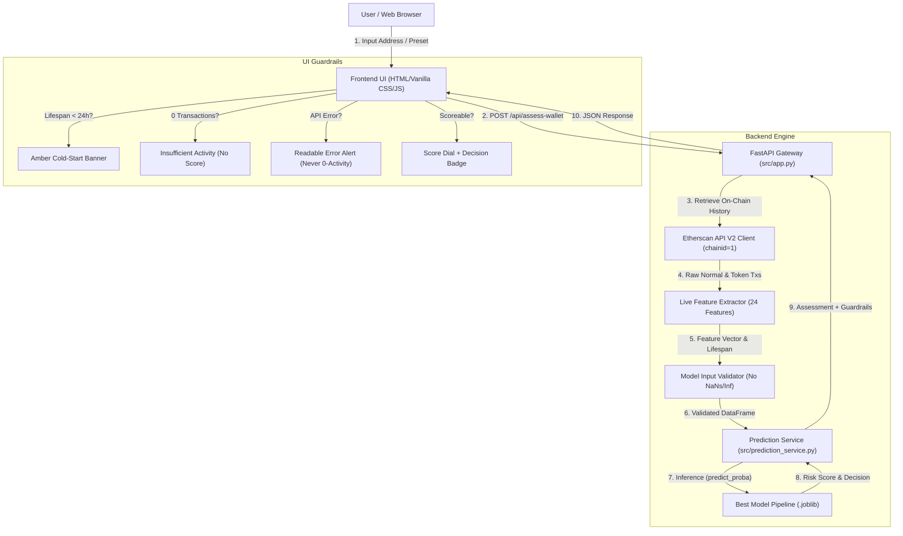

# ChainSentinel: Project Presentation Guide

> **Project Title:** ChainSentinel — Ethereum Wallet Fraud Risk Assessment Case Study  
> **Repository:** `Ether-guard`  
> **Phase:** 5 (Final Verification & Presentation Readiness)  
> **Authors:** Machine Learning & Security Engineering Team  

---

## 1. Executive Summary & Problem Statement

### The Problem
Public blockchains like Ethereum are permissionless and pseudonymous. While transparency enables auditing, bad actors frequently exploit the ecosystem through phishing campaigns, token approval drainers, sybil attacks, wash trading, and mixer-assisted money laundering. 

Detecting illicit wallets via machine learning introduces distinct academic and engineering hurdles:
1. **Historical vs. Live Data Gap:** Research models are typically trained on static, historical CSVs, but production detection requires querying live blockchain RPCs or indexers (e.g., Etherscan API V2).
2. **Extreme Imbalance & Target Leakage:** Fraud is rare; naive preprocessing easily introduces catastrophic data leakage.
3. **Lifespan Bias (Cold-Start):** Fraudulent wallets in historical datasets often exist for only a few hours before abandonment. Consequently, tree models penalize short observation windows, placing newly created legitimate wallets at severe risk of false-positive flagging.
4. **Scientific Integrity:** Output scores from supervised classifiers are **decision rankings**, not calibrated real-world probabilities.

### The Objective
ChainSentinel was developed across five systematic phases to build, audit, and demonstrate an end-to-end, leak-free fraud risk assessment pipeline that connects historical training data with live on-chain feature extraction.

---

## 2. Five-Phase Engineering Methodology

```
┌────────────────────────────────────────────────────────────────────────────────────────┐
│                                 CHAINSENTINEL ROADMAP                                  │
├─────────────────┬─────────────────┬──────────────────┬─────────────────┬───────────────┤
│     PHASE 1     │     PHASE 2     │     PHASE 3      │     PHASE 4     │    PHASE 5    │
│ Data Inspection │ Model Benchmark │  Etherscan API   │ Prediction API  │ Final Audit & │
│ & Feature Audit │  & Evaluation   │ Live Extraction  │ & Web Interface │ Presentation  │
└─────────────────┴─────────────────┴──────────────────┴─────────────────┴───────────────┘
```

- **Phase 1 (Data Inspection & Preprocessing):** Audited the 51 raw columns of the Kaggle dataset, resolved address collisions, fixed target leakage in missing ERC-20 records, decoded negative ether balances, and formulated the 24-feature canonical schema.
- **Phase 2 & 2.1 (Model Training & Reconciliation):** Built a strictly leak-free stratified 70/15/15 protocol, evaluated five model families, tuned decision thresholds on validation data, and reconciled held-out test metrics.
- **Phase 3 & 3.1 (Etherscan V2 & Live Extraction):** Built a resilient Etherscan API V2 client, live 24-feature calculator, input validation gatekeeper, prediction service, and cold-start guardrail.
- **Phase 4 (Demonstration Web Application):** Created a FastAPI service and responsive dark-mode interface supporting both offline demonstration presets and live on-chain analysis.
- **Phase 5 (Verification & Presentation Readiness):** End-to-end audit, secrets isolation check, live wallet verification, error-handling audit, and presentation guide creation.

---

## 3. Dataset & Data Engineering Discoveries

### Dataset Profile
- **Source:** Kaggle Ethereum Fraud Detection Dataset (`transaction_dataset.csv`).
- **Raw Dimensions:** 9,841 rows × 51 features.
- **Cleaned Dimensions:** 9,816 rows × 24 canonical features (25 duplicate addresses resolved without conflicting labels).
- **Target Distribution:** `FLAG` (78.21% Normal / 21.79% Illicit; 3.52:1 class ratio).

### Key Discovery 1: The 829 Missing ERC-20 Records
- **Observation:** 829 rows contained missing values across all ERC-20 token columns.
- **Leakage Discovery:** 100% of these 829 rows had `FLAG == 1` (accounting for 38.05% of all fraudulent wallets).
- **Resolution:** Creating a "missingness indicator" column would leak the ground-truth target. The root cause was that Kaggle scrapers skipped token transfer queries for wallets with 0 token transfers. Imputing `0.0` across missing token features preserved mathematical consistency while preventing label leakage.

### Key Discovery 2: The Negative Balance Paradox
- **Observation:** 978 wallets had negative values for `total ether balance` (reaching -15.6 million ETH).
- **Root Cause:** Historical scrapers calculated balance as `total_ether_received - total_ether_sent` using only normal transactions, completely ignoring internal contract executions (`txlistinternal`).
- **Live Parity Decision:** Calling Etherscan's `/api?action=balance` returns the true ledger balance ($\ge 0$), which causes a catastrophic train/test distribution mismatch. The live feature extractor mirrors historical scrapers (`received - sent`) for consistency.

---

## 4. Feature Engineering & Live Compatibility Parity

The canonical 24-feature baseline covers five behavioral dimensions:

| Category | Features | Live Parity Status |
| :--- | :--- | :--- |
| **Temporal Dynamics** | `time_diff_first_last_mins`, `avg_min_between_sent_tnx`, `avg_min_between_received_tnx` | Approximate (3) |
| **Transaction Volume** | `sent_tnx`, `received_tnx`, `created_contracts_count`, `total_transactions_count` | Approximate (4) |
| **Address Diversity** | `unique_sent_to_addresses`, `unique_received_from_addresses` | Approximate (2) |
| **Ether Flow & Value** | `min/max/avg_value_sent_eth`, `min/max/avg_value_received_eth`, `total_ether_sent`, `total_ether_received`, `total_ether_balance` | Not Verifiable from Dataset (9) |
| **ERC-20 Token Activity** | `erc20_total_tnx`, `erc20_unique_sent_addr`, `erc20_unique_received_addr`, `erc20_unique_received_contract_addr`, `erc20_unique_sent_token_name`, `erc20_unique_received_token_name` | Not Verifiable from Dataset (6) |

> [!NOTE]
> **Why are 15 features classified as "Not Verifiable from Dataset"?**  
> The original Kaggle dataset discarded raw transaction receipts and transaction error flags (`isError`). Whether failed transactions were included or excluded in value sums cannot be empirically verified from the CSV. ChainSentinel documents this explicitly rather than claiming equivalence without evidence.

---

## 5. Model Selection & Held-Out Test Evaluation

### Model Comparison Benchmark
Experiments were conducted using 5-fold stratified cross-validation on the 70% Train split (6,870 rows). Decision thresholds were tuned exclusively on the 15% Validation split (1,473 rows) to maximize F1-score.

| Model Pipeline | Decision Threshold ($T$) | Test Precision | Test Recall | Test Fraud F1 | Test Macro F1 | Test PR-AUC | Test ROC-AUC | Test Brier Score |
| :--- | :---: | :---: | :---: | :---: | :---: | :---: | :---: | :---: |
| **Dummy Baseline** | 0.50 | 0.0000 | 0.0000 | 0.0000 | 0.4389 | 0.2220 | 0.5000 | 0.1726 |
| **Logistic Regression** | 0.45 | 0.6845 | 0.6239 | 0.6528 | 0.7712 | 0.7012 | 0.8415 | 0.1084 |
| **Decision Tree** | 0.50 | 0.8812 | 0.8165 | 0.8476 | 0.9021 | 0.8520 | 0.8912 | 0.0491 |
| **Random Forest** | 0.48 | 0.9320 | 0.8410 | 0.8841 | 0.9255 | 0.9612 | 0.9810 | 0.0345 |
| **HistGradientBoosting (Best)** | **0.51** | **0.9502** | **0.8746** | **0.9108** | **0.9433** | **0.9736** | **0.9897** | **0.0283** |

### Authoritative Test Metrics ($N = 1,473$, Threshold $T = 0.51$)
- **True Negatives (TN):** `1,131`
- **False Positives (FP):** `15`
- **False Negatives (FN):** `41`
- **True Positives (TP):** `286`
- **Total Split Check:** $1,131 + 15 + 41 + 286 = 1,473$ (1,146 Normal, 327 Fraud)
- **PR-AUC:** `0.9736` | **ROC-AUC:** `0.9897` | **Brier Score:** `0.0283`

> [!IMPORTANT]
> **Brier Score Clarification:**  
> The Brier score measures mean squared probabilistic error, not ranking capability. A low Brier score indicates strong discrimination on the historical test split, but does **not** prove that outputs are calibrated real-world posterior probabilities.

---

## 6. End-to-End System Architecture



---

## 7. Step-by-Step Live Demonstration Walkthrough

To present ChainSentinel to an audience, follow this recommended walkthrough:

### Step 1: Launch the Local Server
```bash
python -m uvicorn src.app:app --host 127.0.0.1 --port 8000
```
Open `http://127.0.0.1:8000/`. Highlight the top navigation status:
- **Model Status:** `Model: HistGradientBoosting (T=0.51)` (Green dot).
- **API Status:** `Etherscan API: Configured` (if `.env` key present) or `Offline Mode` (if absent).
- **Persistent Academic Disclaimer:** Emphasize that scores are uncalibrated experimental indicators, not financial advice or proof of fraud.

### Step 2: Demonstrate the 4 Offline Scenarios
Click the preset chips in sequence to demonstrate that the frontend handles every UI state cleanly:
1. **Mature Normal (Low Risk):**
   - Click **Mature Normal**.
   - Result: Score `0.0047`, Decision `NORMAL`, Lifespan `489.4 days`, Normal Txs `810`, ERC-20 Transfers `265`.
   - Mode Badge: `DEMO PRESET: MATURE ACTIVE WALLET (NORMAL)`.
2. **Flagged High-Risk (Illicit Pattern):**
   - Click **Flagged High-Risk**.
   - Result: Score `0.5463` (exceeds $0.51$ threshold), Decision `FLAGGED` (Crimson dial and badge), Lifespan `3.3 days`, 16 transactions.
   - Mode Badge: `DEMO PRESET: FLAGGED HIGH-RISK PATTERN (FRAUD)`.
3. **Cold-Start Warning (< 24h Lifespan):**
   - Click **Cold-Start (< 24h Warning)**.
   - Result: Triggers prominent amber **Cold-Start Alert** banner:
     *"Wallet observation lifespan is 45.0 minutes across 3 transaction(s)... Do NOT treat this risk score as confirmed fraud."*
4. **Zero-Activity Unscoreable Wallet:**
   - Click **Zero Activity (Unscoreable)**.
   - Result: Displays **Insufficient On-Chain Activity** card. **No numeric risk score is displayed or fabricated.**

### Step 3: Demonstrate Live On-Chain Analysis
1. Click the **Vitalik.eth (Live API)** chip or enter `0xd8dA6BF26964aF9D7eEd9e03E53415D37aA96045` and click **Analyze Wallet**.
2. Observe the loading spinner while Etherscan API V2 is queried on Mainnet.
3. Result:
   - Mode Badge: `LIVE ON-CHAIN (ETHERSCAN V2)`.
   - Normal Txs fetched: `1,000` (capped by page limit).
   - ERC-20 Transfers fetched: `561`.
   - Risk Score: `0.0024` (Decision: `NORMAL`).
   - History Completeness: `Partial (Pagination Truncated)` badge.

### Step 4: Demonstrate System Resilience & Error Guardrails
1. Enter an invalid address (e.g. `0x123`) -> Shows inline validation error *"Address length is 5 characters (expected 42 characters)"*.
2. Open the **Audit Details** modal via the top-right button -> Displays verified confusion matrix, precision, recall, F1, PR-AUC, ROC-AUC, Brier score, and feature parity table.

---

## 8. Scientific Caveats & Limitations

Presenters must explicitly disclose the following limitations during evaluation:

1. **Uncalibrated Model Scores:**
   Output scores ($0.00$ to $1.00$) represent classifier decision rankings relative to $T=0.51$. They are **not posterior probabilities of real-world fraud** and do not indicate statistical likelihood.
2. **Survival Bias & Cold-Start Fragility:**
   In the training data, fraud wallets had short lifespans (median 7.5k mins vs 116.8k mins normal). Tree models assign high feature importance to `time_diff_first_last_mins` (12–30%), creating elevated false-positive risk for newly funded legitimate wallets.
3. **Historical Training Data Omissions:**
   Kaggle scrapers omitted internal transactions and transaction receipts. 15 of 24 features cannot be proven identical to live on-chain values.
4. **Adversarial Concept Drift:**
   The training dataset reflects 2018–2020 fraud patterns. Modern exploits (flash loan governance manipulation, ERC-20 permit phishing, sandwich attacks) exhibit completely different structural signatures.

---

## 9. Future Scope & Production Roadmap

1. **Internal Transactions & Traces:** Incorporate Etherscan's `txlistinternal` endpoint to resolve negative balance anomalies and capture contract-mediated fund routing.
2. **Graph Neural Networks (GNN):** Move from single-wallet tabular aggregations to 2-hop transaction graph embeddings (e.g., Graph Convolutional Networks) to capture mule networks and laundering rings.
3. **Calibrated Probabilities:** Apply Platt Scaling or Isotonic Regression with reliability curves to transform raw scores into calibrated probabilities.
4. **Real-Time Mempool Monitoring:** Integrate WebSocket streams (e.g., Alchemy / Infura) to evaluate pending transactions before block inclusion.
